# VOKO — Modelo de Datos Relacional y Diagrama Entidad-Relación
**Versión:** 1.0.0 — Hito 0  
**Motor:** PostgreSQL 16  
**ORM:** TypeORM (exclusivamente con migraciones versionadas)  

---

## 1. Diagrama Entidad-Relación (Mermaid)

```mermaid
erDiagram
    users ||--o{ business_memberships : has
    users ||--o{ auth_sessions : owns
    users ||--o{ password_resets : requests
    users ||--o{ invitations : receives
    users ||--o{ appointments : "books as customer"
    users ||--o{ appointment_events : triggers

    businesses ||--|{ branches : operates
    businesses ||--o{ business_memberships : includes
    businesses ||--o{ services : offers
    businesses ||--o{ resources : manages
    businesses ||--o{ availability_rules : defines
    businesses ||--o{ availability_exceptions : registers
    businesses ||--o{ sessions : schedules
    businesses ||--o{ appointments : contains
    businesses ||--o{ invitations : generates
    businesses ||--|| business_settings : configures
    businesses ||--o{ audit_logs : logs

    branches ||--o{ resources : hosts
    branches ||--o{ sessions : locates
    branches ||--o{ appointments : locates
    branches ||--o{ availability_rules : overrides
    branches ||--o{ availability_exceptions : overrides

    services ||--o{ service_resources : enables
    services ||--o{ sessions : categorizes
    services ||--o{ appointments : describes

    resources ||--o{ service_resources : assigned_to
    resources ||--o{ availability_rules : has_individual
    resources ||--o{ availability_exceptions : has_individual
    resources ||--o{ sessions : leads
    resources ||--o{ appointments : allocated_to

    sessions ||--o{ appointments : aggregates

    appointments ||--|{ appointment_events : tracks
    appointments ||--o{ notifications : triggers

    users {
        uuid id PK
        varchar first_name
        varchar last_name
        varchar email UK
        varchar phone
        varchar password_hash
        date birth_date
        boolean is_active
        boolean is_superadmin
        timestamptz email_verified_at
        timestamptz created_at
        timestamptz updated_at
        timestamptz deleted_at
    }

    businesses {
        uuid id PK
        varchar name
        varchar slug UK
        text description
        varchar industry
        varchar logo_url
        varchar contact_email
        varchar phone
        varchar tax_id
        varchar timezone
        varchar currency
        enum status
        timestamptz created_at
        timestamptz updated_at
        timestamptz deleted_at
    }

    branches {
        uuid id PK
        uuid business_id FK
        varchar name
        varchar address
        varchar city
        varchar phone
        boolean is_default
        boolean is_active
        timestamptz created_at
        timestamptz updated_at
    }

    business_memberships {
        uuid id PK
        uuid business_id FK
        uuid user_id FK
        enum role
        jsonb custom_permissions
        enum status
        timestamptz joined_at
        timestamptz created_at
        timestamptz updated_at
    }

    services {
        uuid id PK
        uuid business_id FK
        varchar name
        text description
        integer duration_minutes
        decimal price
        varchar currency
        integer buffer_before_minutes
        integer buffer_after_minutes
        integer min_booking_notice_minutes
        integer max_booking_advance_days
        integer cancellation_deadline_minutes
        enum booking_mode
        enum confirmation_mode
        boolean is_active
        timestamptz created_at
        timestamptz updated_at
    }

    resources {
        uuid id PK
        uuid business_id FK
        uuid branch_id FK
        uuid user_id FK "nullable (para empleados/staff)"
        varchar name
        enum resource_type "STAFF, ROOM, COURT, BOX, EQUIPMENT"
        text description
        boolean is_active
        timestamptz created_at
        timestamptz updated_at
    }

    service_resources {
        uuid service_id PK, FK
        uuid resource_id PK, FK
        timestamptz created_at
    }

    availability_rules {
        uuid id PK
        uuid business_id FK
        uuid branch_id FK "nullable"
        uuid resource_id FK "nullable"
        smallint day_of_week "0=Domingo, 6=Sabado"
        time start_time
        time end_time
        boolean is_active
        timestamptz created_at
        timestamptz updated_at
    }

    availability_exceptions {
        uuid id PK
        uuid business_id FK
        uuid branch_id FK "nullable"
        uuid resource_id FK "nullable"
        timestamptz start_time
        timestamptz end_time
        enum exception_type "HOLIDAY, VACATION, BREAK, EXTRAORDINARY_OPENING, BLOCK"
        varchar reason
        boolean is_blocking
        timestamptz created_at
        timestamptz updated_at
    }

    sessions {
        uuid id PK
        uuid business_id FK
        uuid branch_id FK
        uuid service_id FK
        uuid resource_id FK "nullable"
        timestamptz start_time
        timestamptz end_time
        integer max_capacity
        integer current_attendees
        enum status "OPEN, FULL, CANCELLED, COMPLETED"
        timestamptz created_at
        timestamptz updated_at
    }

    appointments {
        uuid id PK
        uuid business_id FK
        uuid branch_id FK
        uuid service_id FK
        uuid resource_id FK "nullable"
        uuid session_id FK "nullable"
        uuid customer_id FK
        timestamptz start_time
        timestamptz end_time
        enum status "PENDING, CONFIRMED, CANCELLED_BY_CUSTOMER, CANCELLED_BY_BUSINESS, COMPLETED, NO_SHOW"
        decimal snapshot_price
        integer snapshot_duration_minutes
        varchar snapshot_currency
        text customer_notes
        text internal_notes
        timestamptz cancelled_at
        varchar cancellation_reason
        uuid cancelled_by_user_id FK "nullable"
        timestamptz created_at
        timestamptz updated_at
    }

    appointment_events {
        uuid id PK
        uuid appointment_id FK
        enum event_type "CREATED, CONFIRMED, RESCHEDULED, STATUS_CHANGED, CANCELLED, ATTENDED, NO_SHOW"
        enum previous_status
        enum new_status
        uuid actor_user_id FK "nullable"
        jsonb metadata
        timestamptz created_at
    }

    invitations {
        uuid id PK
        uuid business_id FK "nullable"
        uuid invited_by_user_id FK
        varchar email
        varchar token_hash UK
        enum invitation_type "CUSTOMER, STAFF, ADMIN"
        enum status "PENDING, ACCEPTED, EXPIRED, REVOKED"
        timestamptz expires_at
        timestamptz accepted_at
        timestamptz created_at
    }

    notifications {
        uuid id PK
        uuid business_id FK "nullable"
        uuid recipient_user_id FK "nullable"
        varchar recipient_email
        enum event_type
        enum channel "EMAIL, N8N_WEBHOOK"
        enum status "PENDING, SENT, FAILED, RETRYING"
        integer retry_count
        text last_error
        jsonb payload
        timestamptz scheduled_at
        timestamptz processed_at
        timestamptz created_at
    }

    auth_sessions {
        uuid id PK
        uuid user_id FK
        varchar refresh_token_hash UK
        varchar user_agent
        varchar ip_address
        boolean is_revoked
        timestamptz expires_at
        timestamptz created_at
        timestamptz updated_at
    }

    password_resets {
        uuid id PK
        uuid user_id FK
        varchar token_hash UK
        boolean is_used
        timestamptz expires_at
        timestamptz created_at
    }

    business_settings {
        uuid id PK
        uuid business_id FK, UK
        boolean allow_public_booking
        boolean require_email_verification
        integer default_slot_interval_minutes
        varchar brand_primary_color
        varchar brand_secondary_color
        jsonb custom_notification_config
        timestamptz created_at
        timestamptz updated_at
    }

    audit_logs {
        uuid id PK
        uuid business_id FK "nullable"
        uuid actor_user_id FK "nullable"
        varchar action
        varchar entity_name
        uuid entity_id
        jsonb diff_data
        varchar ip_address
        varchar user_agent
        timestamptz created_at
    }
```



---

## 2. Detalle de Reglas de Integridad y Restricciones de Base de Datos

### 2.1. Unicidad e Índices Compuestos
1. **`users`:**
   - `UNIQUE(email)` (normalizado a minúsculas mediante índice funcional o trigger).
2. **`businesses`:**
   - `UNIQUE(slug)`
3. **`business_memberships`:**
   - `UNIQUE(business_id, user_id)`: Un usuario no puede tener más de una membresía activa en el mismo negocio.
4. **`service_resources`:**
   - `PRIMARY KEY(service_id, resource_id)`
5. **`appointments` (Prevención de Solapamiento):**
   - Índice compuesto: `CREATE INDEX idx_appointments_res_time ON appointments(resource_id, start_time, end_time) WHERE status IN ('PENDING', 'CONFIRMED');`
   - Índice compuesto por tenant: `CREATE INDEX idx_appointments_biz_time ON appointments(business_id, start_time);`
6. **`sessions`:**
   - Índice compuesto: `CREATE INDEX idx_sessions_biz_time ON sessions(business_id, start_time);`
   - Check constraint: `CHECK (current_attendees <= max_capacity)`
   - Check constraint: `CHECK (current_attendees >= 0)`

### 2.2. Manejo de Bajas Lógicas vs Bajas Físicas
- **Baja Lógica (`deleted_at`):**
  - Aplicada a: `users`, `businesses`.
  - Motivo: Conservar la trazabilidad fiscal, legal y de auditoría histórica de turnos y facturas pasadas.
- **Desactivación (`is_active`):**
  - Aplicada a: `branches`, `services`, `resources`, `availability_rules`.
  - Motivo: Un servicio inactivo no puede recibir nuevas reservas a futuro, pero sus turnos pasados o ya confirmados no sufren corrupción referencial.
- **Baja Física Restringida:**
  - Tablas transaccionales como `appointments` y `appointment_events` nunca se borran físicamente; cambian de estado a cancelado con fecha y motivo explícito.

### 2.3. Transacciones y Bloqueos Concurrenciales
- **Reserva Individual / Recurso:**
  ```sql
  -- Dentro de transacción SERIALIZABLE o READ COMMITTED con verificación:
  SELECT id FROM appointments
  WHERE resource_id = :resourceId
    AND status IN ('PENDING', 'CONFIRMED')
    AND start_time < :requestedEndTime
    AND end_time > :requestedStartTime
  FOR UPDATE;
  ```
  Si se retorna alguna fila, la transacción aborta con error de conflicto 409 (`SLOT_UNAVAILABLE`).

- **Reserva de Sesión Grupal (Cupos):**
  ```sql
  SELECT current_attendees, max_capacity, status
  FROM sessions
  WHERE id = :sessionId
  FOR UPDATE;
  ```
  Garantiza que dos clientes haciendo click al mismo milisegundo en el último cupo no causen overbooking.
